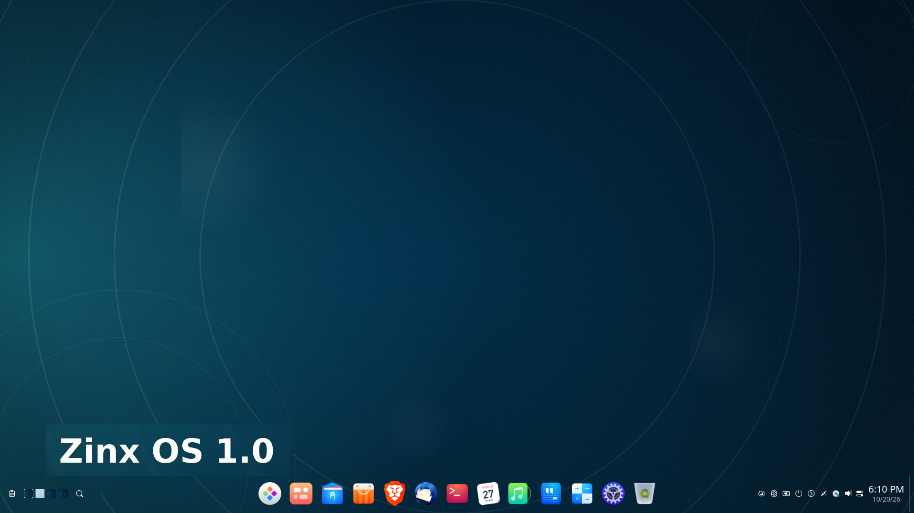

# Zinx OS 1.0 is here!

**A beautiful, private, Windows-familiar Linux desktop.**

Zinx OS 1.0 is a free, open-source (GPLv3) desktop operating system built on Ubuntu 24.04 LTS with the Deepin Desktop Environment. It pairs a polished, modern interface with privacy-respecting defaults, an encrypted office suite, enterprise-friendly domain tools, and a remote desktop experience designed for real work — all at no cost.

## Screenshots

*Zinx OS 1.0 desktop*

## Zinx OS 1.0 vs Windows 11

| | Windows 11 | Zinx OS 1.0 |
|---|---|---|
| **Price** | Paid license | **Free** — download, install, and share |
| **Office suite** | Microsoft 365 subscription | **CryptPad included** — encrypted and private; docs, sheets, slides, and forms; works offline; no cloud account required; zero telemetry |
| **Updates** | Forced reboots on Microsoft's schedule | **User-controlled, selectable updates** — a Windows-style list with a details pane; pick exactly what to install and when to reboot |
| **Remote Desktop** | RDP | **Full-session RDP with H.264** — up to 41x less bandwidth in our tests; bidirectional clipboard; resize-aware cursors; session handoff (walk up to the machine and your session follows you) |
| **Active Directory** | Manual domain join | **Auto-detects the domain when you plug in the cable**, with a guided join wizard |
| **Telemetry** | Extensive | **None** — local-first by design |
| **Customization** | Limited | **Full theme engine** — light/dark, rounded corners, translucent dock |
| **App feedback** | — | **Built-in Zinx Feedback app** — privacy-safe and consent-gated |
| **Backup** | — | **Timeshift system snapshots included** |
| **Online account** | Pushes a Microsoft account | **None required** — a local account is all you need |
| **Ads & sponsored apps** | Yes — Start-menu suggestions and promoted apps | **None** — no ads, no sponsored apps, ever |
| **Crash reporting** | Sent to Microsoft | **None** — vendor crash reporting is disabled; diagnostics never leave the machine |
| **Open source** | Closed source | **GPLv3** — every line is open and auditable |
| **Malware resistance** | Signature-AV treadmill | **Linux permission model by design** — polkit-mediated privileges, no everyday admin rights |
| **Firewall** | Built-in | **Built-in UFW firewall, enabled by default** — incoming denied, outgoing allowed |

## 🎨 Beautiful by default

- Deepin Desktop Environment with a translucent fashion-mode dock and rounded corners
- Launchpad with adaptive icons
- Light and dark themes
- Display scaling that applies without logging out

## 🔒 CryptPad office, included

- Private, encrypted office suite: documents, spreadsheets, slides, and forms
- On-demand design — 0 MB used while idle
- Works fully offline
- Opens `.docx`, `.xlsx`, `.pptx`, and `.odt` files by default

## 🔄 Windows-style updates, under your control

- Selectable update list with a details pane — see exactly what each update does
- Security updates grouped for quick review
- Clear reboot banner instead of surprise restarts
- GitHub-powered CryptPad updates keep the office suite current

## 🏢 Enterprise-ready

- Active Directory auto-detection when the network cable is plugged in
- Guided domain join wizard built on realmd/sssd
- Polkit-secured operations, including a GUI leave flow

## 🖥️ Remote Desktop done right

- Full-session RDP
- H.264 encoding — up to 41x less bandwidth in our tests
- Bidirectional clipboard
- Server-side, resize-aware cursors
- Single-session handoff with lock: walk up to the machine and your session follows

## 🛡️ Security & privacy

- **No telemetry, no crash uploads** — vendor crash reporting (apport/whoopsie) is disabled; diagnostics never leave the machine
- **No ads, no sponsored apps, no forced online account**
- **Open and auditable** — GPLv3-licensed, top to bottom
- **Linux permission model by design** — polkit privilege separation, no everyday admin rights
- **Privacy-gated RDP** — the physical screen blanks while you're remoted in, and the session locks when you disconnect
- Local-first Zinx Feedback app with automatic secret redaction, gated by your consent
- System services listen on loopback only — CryptPad binds to `127.0.0.1`
- **systemd-hardened local services** — ProtectSystem=strict, NoNewPrivileges, PrivateTmp
- **UFW firewall enabled by default** — default-deny incoming, default-allow outgoing
- **Timeshift system snapshots** for fast, easy recovery

## 📦 Curated apps, ready to go

- **Brave** browser and **Thunderbird** mail
- **VLC** media player
- **CryptPad** as the default office suite (replacing OnlyOffice)
- **Timeshift** backups and **GParted** partition editor
- The Deepin application suite: Files, Terminal, Text Editor, Calendar, Music, Movie, Album, Draw, Reader, Screen Recorder, Calculator, and System Monitor

## 🪨 Built on solid ground

- Ubuntu 24.04 LTS base with its security update stream
- Five-year support window from the LTS lifecycle
- Free and open-source under the GNU GPLv3 license

## Download and get involved

- **[Releases](https://github.com/happyrwandan/Zinx-OS/releases)** — download Zinx OS 1.0
- **[Issues](https://github.com/happyrwandan/Zinx-OS/issues)** — feedback and bug reports; public testers are welcome

Zinx OS is licensed under the [GNU General Public License v3.0](LICENSE).
